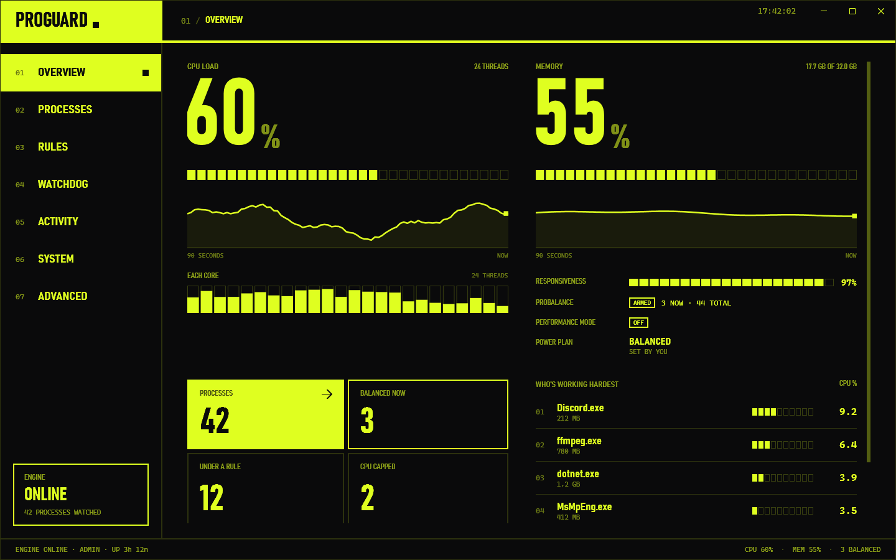
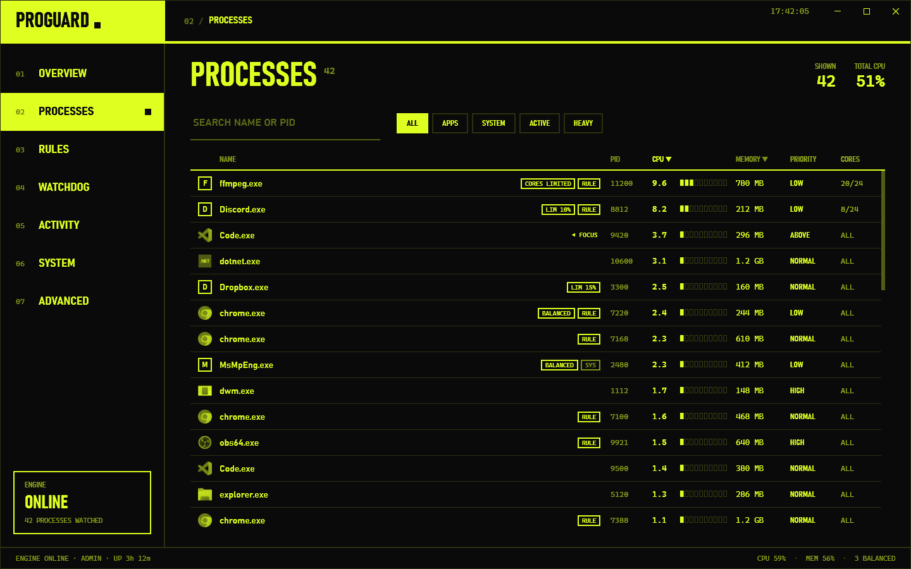

# ProGuard

[](https://github.com/ayrball/ProGuard/actions/workflows/ci.yml)
[](https://github.com/ayrball/ProGuard/releases/latest)
[](LICENSE)

ProGuard keeps a Windows PC responsive. A Windows service watches every process and, when the machine is under load,
temporarily lowers the priority of the programs responsible so whatever you are using stays smooth (ProBalance). It
applies the rules you set for individual programs every time they run, watches for programs that misbehave
(Watchdog), trims memory when RAM is tight (SmartTrim) and switches power plans to match what you are doing
(Performance Mode, IdleSaver). A WPF window shows what the engine is doing and lets you change it, with or without
administrator rights. It is an open-source alternative to Process Lasso, built in C# on .NET 10.



*Rendered with `tools/ProGuard.Preview` against its stand-in engine, which is why the processes are sample ones.*

**[Download the latest release](https://github.com/ayrball/ProGuard/releases/latest)**: an MSI installer or a
portable zip, 64-bit Windows 10 or 11, no .NET install needed.

## What it does

| | |
| --- | --- |
| **ProBalance** | Restrains CPU hogs while the system is loaded and restores them after, with tunable thresholds; never touches the program you are using. Optional restraint by affinity, I/O priority or efficiency mode, and unparking every core meanwhile. |
| **Rules** | Per-program priority, I/O and memory priority, affinity, CPU Sets, efficiency mode, GPU priority, a CPU limit (hard cap or affinity reduction), startup boost, instance limits and balancing, keep-running, disallowed programs, a power plan while it runs, and "set at launch" through Image File Execution Options. |
| **Watchdog** | When a program's CPU, memory, running time or instance count stays over a threshold: terminate, restart, change its priority or affinity for a while, trim it, launch something, log or notify. |
| **SmartTrim** | Working-set trimming on a schedule while RAM is tight, standby-list and file-cache purges. |
| **Power** | Performance Mode for listed programs, detected games and Steam; IdleSaver after a period without input; a load-based plan switcher; the Windows 11 power mode; your plan put back if the engine dies holding one. |
| **System** | System timer resolution, CPU tuning per power plan (core parking, processor states, boost, EPP), config profiles with export and import, an activity log and a log viewer. |



## Architecture

```
 user session                                  session 0
 ┌──────────────────────────┐   named pipe    ┌──────────────────────────────┐
 │ ProGuard.UI (WPF)        │ ◄─────────────► │ ProGuard.Engine (service)    │
 │ thin client, no engine   │  JSON, one      │ ProBalance · rules · Watchdog│
 │ logic; works unelevated  │  line per call  │ SmartTrim · power · logs     │
 └──────────────────────────┘                 │ EF Core + SQLite in          │
 ┌──────────────────────────┐   foreground,   │ %ProgramData%\ProGuard       │
 │ ProGuard.SessionAgent    │ ─────────────►  └──────────────────────────────┘
 │ one per signed-in user   │   idle time
 └──────────────────────────┘
```

- **The engine** (`src/ProGuard.Engine`) runs as the `ProGuardEngine` Windows service (LocalSystem) or as a console
  process for development. All the logic lives there and in `src/ProGuard.Core`: process monitoring, the ProBalance
  algorithm, rule application, the Watchdog, SmartTrim, power plan arbitration and CPU tuning. Settings, rules,
  Watchdog rules and config profiles are an EF Core SQLite database that the engine owns.
- **The UI** (`src/ProGuard.UI`) is a thin client. It holds no engine logic and has no reference to Core; it polls a
  snapshot over a named pipe and sends commands. The engine checks the caller of every request: a standard user can
  manage their own processes, administrators can manage everything, and anything refused says why in the window,
  with a one-click "Restart as administrator".
- **The pipe contract** (`src/ProGuard.Shared`) is one JSON message per line, answered by exactly one reply, with
  DTOs shared by both sides. The engine impersonates the caller for the authorization check only.
- **The session agent** (`src/ProGuard.SessionAgent`) is a windowless process the engine starts in every user session
  (a service in session 0 cannot see the desktop) to report the foreground program and idle time, which ProBalance's
  foreground exemption, Foreground Boost and IdleSaver depend on.
- **Previews and tests.** `tools/ProGuard.Preview` renders every page and dialog of the real UI to PNG against a
  stand-in engine, so UI changes can be reviewed without an engine or administrator rights; CI uploads the images for
  every pull request. `tests/ProGuard.Tests` (xUnit) covers the engine services, the pipe authorization policy, the
  view models and the installer's helpers.
- **Packaging.** `installer/` builds a WiX v5 MSI (service registration with recovery actions, upgrade in place,
  optional start at sign-in, Process Lasso detection) and a portable zip, both from self-contained single-file
  publishes. [docs/installer.md](docs/installer.md) explains the decisions.

How Process Lasso implements each feature, and where ProGuard still differs, is written up in
[docs/process-lasso-internals.md](docs/process-lasso-internals.md).

## Install

Download `ProGuard-<version>-x64.msi` from [Releases](https://github.com/ayrball/ProGuard/releases) and run it
(64-bit Windows 10 or 11; no .NET install needed). It installs ProGuard in `C:\Program Files\ProGuard`, runs the
engine as the `ProGuardEngine` service and adds ProGuard to the Start menu. Tick or untick "Start ProGuard in the
notification area when I sign in" (on by default; you can change it later in ProGuard's System page). If Process Lasso
is installed, the installer warns you, since the two fight over the same processes; it never touches Process Lasso.

Silent install from an elevated prompt: `msiexec /i ProGuard-<version>-x64.msi /qn` (add `START_AT_SIGNIN=0` to skip
the tray icon at sign-in, or `START_AS_ADMIN=0` so the window doesn't ask for administrator rights each time it starts).

**Upgrade:** run the newer MSI. It stops the service, replaces the files and starts the service again, keeping your
settings, rules and logs (`C:\ProgramData\ProGuard`) and your start-at-sign-in choice.

**Uninstall:** Settings > Apps > Installed apps > ProGuard > Uninstall. This stops and removes the service, closes
ProGuard and deletes the program files. `C:\ProgramData\ProGuard` is kept; to delete it too, run
`msiexec /x ProGuard-<version>-x64.msi /qn REMOVE_DATA=1`, or run the MSI again, choose Remove and tick
"Also delete ProGuard's settings, rules and logs".

Each release also has a portable zip, `ProGuard-<version>-portable-win-x64.zip`: unzip and run `Start ProGuard.cmd`,
nothing installed. Its README.txt covers both. How the installer works and how to build it:
[docs/installer.md](docs/installer.md). Release notes are in [docs/releases](docs/releases).

The builds are not code-signed yet, so Windows SmartScreen warns about an unknown publisher: click "More info" >
"Run anyway".

## Repository layout

- `src/ProGuard.Engine` — the engine (Windows service, or a console process for development)
- `src/ProGuard.UI` — the WPF UI
- `src/ProGuard.Core`, `src/ProGuard.Shared` — engine logic and the UI/engine contract
- `src/ProGuard.SessionAgent` — the per-session foreground reporter
- `tools/ProGuard.Preview` — renders the UI to PNG against a stand-in engine
- `tests/ProGuard.Tests` — xUnit tests
- `installer/` — the MSI (WiX v5) and the portable zip
- `docs/` — schema, installer, service verification, release notes, and notes on how Process Lasso does things

## Build, run, test

Windows 10/11 and the .NET 10 SDK (pinned by `global.json`).

```powershell
dotnet build ProGuard.sln
.\run.ps1            # starts the engine (unless already running), then the UI; run elevated to manage system processes
.\run.ps1 -Preview   # renders every page and dialog to artifacts\preview\ without a real engine
dotnet test ProGuard.sln
```

Two tests skip unless the test host is elevated or runs as LocalSystem. To install a development build of the engine as
a service, see `src/ProGuard.Engine/Installer/install-service.ps1` and `docs/service-verification.md` (it refuses to
run while the MSI is installed).

```powershell
.\installer\build.ps1 -Version 1.0.0 -Portable   # MSI and portable zip in artifacts\installer\
```

The version in `src/Directory.Build.props` is what a plain build carries; `build.ps1` and the release workflow
override it with the version they are given, so a built installer always says what its tag says.

## CI

Every pull request and push to `main` builds in Release, runs the tests on `windows-latest`, and uploads the UI preview
PNGs as the `ui-preview` artifact. Test results (TRX, plus dumps if a test hangs for 5 minutes) are uploaded as
`test-results` when the tests fail. It also builds the MSI (version `0.0.<run number>`, unsigned) and uploads it as the
`installer` artifact.

Pushing a `v*` tag (`v1.0.0`, or `v1.1.0-beta.1` for a pre-release) runs `.github/workflows/release.yml`: it builds the
MSI and the portable zip at that version and attaches both, with checksums, to the GitHub Release for that tag,
creating the release with generated notes if none exists yet. Code signing is wired in but off; see
[docs/installer.md](docs/installer.md#code-signing).

## Built by

[ayrball](https://github.com/ayrball). Questions, bug reports and contract enquiries are welcome through GitHub.

## License

Licensed under the [PolyForm Noncommercial License 1.0.0](LICENSE). You are free to use, modify and share this for personal, hobby, educational, research and other noncommercial purposes.

**Commercial use** (selling it, building a paid product or service on it, or using it in a business) needs a separate license from the author. Commercial licenses are available: get in touch via [github.com/ayrball](https://github.com/ayrball) to discuss terms.
