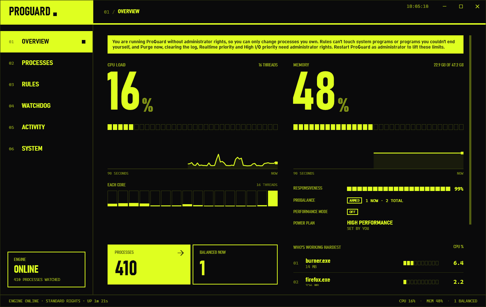
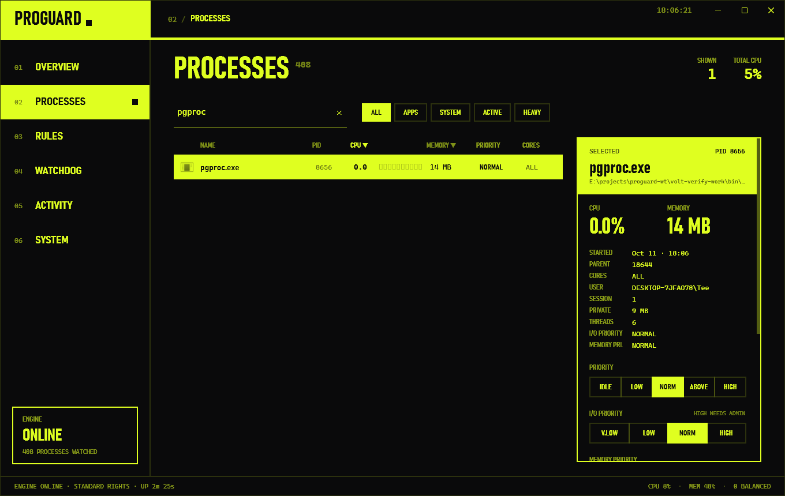

# Volt UI deployment verification

The Volt UI (PR #13) checked the way it deploys: the engine installed as the LocalSystem service in session 0, and the
UI run from its Release publish by the signed-in user, unelevated, then once elevated. Run on 2026-10-11, 18:03 to
19:20, on the development machine (Windows 11 Pro 26200, 16 logical CPUs, 47 GB RAM). Process Lasso's
ProcessGovernor service was already stopped and its GUI not running; both were left that way.

## How it was run

- **Install**: `dotnet publish -c Release` for the engine and the UI; `install-service.ps1` from an elevated
  PowerShell. `sc qc ProGuardEngine`: `WIN32_OWN_PROCESS`, `AUTO_START`, `LocalSystem`, binary in
  `C:\Program Files\ProGuard\Engine`; `sc qfailure`: restart after 5 s, 10 s, 60 s. The database already in
  `C:\ProgramData\ProGuard` was backed up first and put back after the final uninstall.
- **Elevated steps**: four UAC prompts in total. The first installed the service. The second reinstalled it with the
  first fixes, which doubled as the engine-restart check; its elevated UI exited at once, because the published UI
  predated the fix in ca0eabe. The third ran the admin checks. The fourth reinstalled with the last engine fixes,
  re-ran the checks for them, then uninstalled the service and restored the database.
- **Driving the UI without the user's mouse, keyboard or screen**: for the first few minutes the UI ran on the user's
  desktop and was driven only through UI Automation (UIA) patterns; the two screenshots below are from then. From
  Processes onwards it ran on a separate desktop of the same session (`CreateDesktop` plus `STARTUPINFO.lpDesktop`),
  with a UIA client on that desktop using the Invoke, Value, Toggle, SelectionItem, ExpandCollapse and RangeValue
  patterns. No input was simulated and no window was activated. Toasts were read as UIA items. The tools are in
  `tools/volt-uia/` (README there).
- **Evidence**:
  - What Windows reports, read with Win32 calls (`tools/volt-uia/probe.cs`): priority class, affinity, I/O priority
    (`NtQueryInformationProcess` class 33), memory priority, EcoQoS control/state, priority boost and default CPU Sets.
  - `Win32_Process` (session and command line), `powercfg /getactivescheme`, `HKCU\...\Run`,
    `HKCU\...\DirectX\UserGpuPreferences`, and process CPU time.
  - The engine's log (`%ProgramData%\ProGuard\logs\engine.log`).
  - A pipe client running as the same unelevated user (`tools/volt-uia/pipe.ps1`).
- **Test programs**: `burner.exe` (N busy threads for S seconds, then idle) copied under the names the rules match
  (`pgrule.exe`, `pgcap2.exe`, …), plus a windowless copy for the Watchdog Launch action.

**How each check was done.** **UIA**: clicked in the real UI through UI Automation. **Pipe**: the same request the UI
sends, from a script running as the same account. **Unit**: covered by unit tests only.

## Results

| Page | Check | Result | How |
|---|---|---|---|
| Overview | Live numbers, per-core bars, responsiveness, standard-rights banner | PASS | UIA, screenshot |
| Processes | Every inspector action on the user's own process | PASS after fixes | UIA |
| Processes | Every action on a SYSTEM process refused with a readable message | PASS after fix (Trim) | UIA |
| Processes | Inspector fields, tags, icons | PASS | UIA |
| Processes | Right-click menu | **not driven** | needs real input |
| Rules | Create, edit, delete with every editor section; applied to real processes | PASS | UIA, probe |
| Rules | Refused contents refused with readable reasons | **FAIL → fixed** (2 holes) | UIA, unit |
| Watchdog | CPU rule with Notify raises a notification | PASS (engine event; balloon not seen) | UIA, pipe, unit |
| Watchdog | Restart and Keep Running relaunch into session 1 | PASS | UIA, `Win32_Process` |
| Activity | Entries appear; Clear Log refused for standard user, works for admin | **FAIL → fixed** (didn't empty the page) | UIA, pipe |
| System | Every setting saves, survives an engine restart, takes effect | PASS | UIA, pipe, `powercfg` |
| System | Performance Mode, power plans, IdleSaver, load switcher, Purge Now (admin) | PASS | UIA, `powercfg`, log |
| Tray | Minimise and close to tray, show again, quit when the option is off | PASS | UIA |
| Tray | Tray menu and balloons | **not driven** | no taskbar on the test desktop |
| Tray | Start with Windows (HKCU Run value) | PASS | UIA, registry |
| Elevated UI | Admin-only paths | PASS after fix | UIA |
| All | UI keeps working across a service restart | **FAIL → fixed** | UIA, unit |

### Overview

- With one burner thread pinned to CPU 15: UI CPU **16%**, against the `\Processor(_Total)` counter's 15.1% and 14.3%
  over the same seconds. The last per-core bar was full and the others low (`\Processor(15)` = 100%).
  burner.exe topped "Who's working hardest" at 6.4% (one of 16 threads). ProBalance showed 1 restrained, and the
  status strip read `1 BALANCED`.
- Responsiveness 99–100%, the CPU and memory sparklines moving, and the power plan shown as `HIGH PERFORMANCE · SET BY
  YOU`, matching `powercfg`.
- The standard-rights banner was shown unelevated (its wording was updated, see Rules) and absent in the elevated UI.

### Processes

Own process (`pgproc.exe`). Every value is as the probe read it after the click, and every click showed a toast:

| Action | Read back |
|---|---|
| Priority IDLE / LOW / ABOVE / HIGH / NORM | `Idle`, `BelowNormal`, `AboveNormal`, `High`, `Normal` |
| I/O V.LOW / LOW / NORM | `io=0`, `1`, `2` |
| I/O HIGH, unelevated | not sent: toast "I/O priority High needs administrator rights…" (`io` stayed 1) |
| I/O HIGH, elevated UI | `io=3` |
| Memory V.LOW … NORM | `mem=1` … `5` |
| Eco on / off | EcoQoS `0x1/0x1`, then `0x1/0x0` (off is explicit, as Process Lasso does) |
| Cores: first half, one per core, 03+15, all | `0xFF`, `0x5555`, `0x8008`, `0xFFFF`; none picked shows "PICK AT LEAST ONE" with Apply disabled |
| CPU cap 10% on a 4-thread burner | 25% of the machine before, **10.3%** capped, 25% after Remove cap; row tag `LIM 10%` |
| Trim | working set 14 MB → 0 MB, toast "freed 14 MB" |
| Pause / Resume | 3 of 3 threads `Suspended`, then 0 of 3; `PAUSED` tag |
| End | process gone |
| End tree (cmd → cmd → pgtree) | confirm "cmd.exe and 3 processes it started will end"; all gone |

- **Inspector fields** matched `Win32_Process`: parent 18644, session 1, private 9 MB, user, start time, I/O and
  memory priority. Threads showed 6 against 5 a moment later, as the process settled.
- **Tags** seen: `LIM 10%`, `BALANCED`, `PAUSED`, `ECO`, `RULE`, `SYS`, `◀ FOCUS`.
- **Icons**: apps show their icon. System processes show a monogram (S, W), since the UI can't read their path.

**SYSTEM process (`spoolsv.exe`, unelevated)**: priority, I/O, memory priority, Eco, cores, CPU cap, pause, end and end
tree were all refused, e.g. `Access denied: DESKTOP-7JFAO78\Tee may not change the priority of process 4324: it belongs
to another user, is elevated or protected, or is not running. Run ProGuard as administrator to do this.` End and end
tree asked for confirmation first ("END A SYSTEM PROCESS?"). spoolsv was unchanged afterwards.

- **Trim: FAIL → fixed (525e5a6).** The engine refused it (`Refused IPC request Command/TrimWorkingSet (pid 4324)`),
  but the UI then showed "spoolsv.exe · freed 0 B" over the refusal: it read the failed query's default 0 as a
  result. System → Trim everything had the same mistake.
- **Elevated UI**: spoolsv to Above Normal and back to Normal (the probe confirmed both), and Trim freed 19 MB.
- **Right-click menu: not driven.** WPF opens it only on a real right-click or the Apps key. Its items call the same
  commands as the inspector buttons above. The only action unique to it, Realtime priority, was checked through a
  rule (see Rules) and over the pipe.
- **Cosmetic (f1da044)**: the CPU cap presets read "5 10 25 50 75" without the %.

### Rules

**Created through the editor, then checked on a newly started process:**

| Rule | Read back from the process |
|---|---|
| `pgrule.exe`: Above Normal, cores 4–7, never balance, I/O Low, memory Low, Eco on, thread boost disabled, GPU priority Low, GPU preference High, re-apply | `AboveNormal`, affinity `0xF0`, `io=1`, `mem=2`, EcoQoS `0x1/0x1`, boost disabled. `HKCU\...\UserGpuPreferences\…\pgrule.exe = GpuPreference=2;`. GPU priority: log `Applied GPU priority Below Normal` (the probe couldn't read it, even elevated) |
| same rule edited to LOW | the next instance came up `BelowNormal` (the editor loaded the rule's values; heading "EDIT RULE") |
| `pgset.exe`: CPU Sets picked in the dialog (258, 259), startup boost High 5 s | CPU Sets `258 259`; priority `Normal` → `High` at 0.5 s → `Normal` at 5.5 s |
| `pgcap2.exe`: hard cap 10%, limiter ≥3% for 2 s → −8 cores for 10 s | affinity `0xFFFF` → `0xFF` at about 5 s → `0xFFFF` at 15 s; CPU over eight 3 s windows averaged 10.5% (individual windows 4.9–13.3%) |
| `pginst.exe`: at most 2, balancer EQUAL | third copy ended (`Instance limit … terminated 35680`); the other two got `0xFF` and `0xFF00` |
| `pgkeep.exe`: keep running | see Watchdog |
| delete `pgcap2.exe` | the next pgcap2 ran uncapped (24.9%) |

**Re-apply if changed**: I/O, memory priority and Eco, changed from the Processes page, were put back within about
2 s (`Re-applied I/O priority Low (was Normal) …`). As its place in the Advanced section suggests, re-apply covers
those settings only; priority and affinity are applied when the process starts.

**Editor checks**:
- Realtime is disabled with an ADMIN tag for a standard user and enabled for an administrator.
- Other refusals, each with its reason: block and keep running together; an empty name; a limiter threshold of 150%;
  removing 16 cores on a 16-thread machine; a duplicate name.

**Refused contents: FAIL → fixed (0bd5638, f93cf8b).** Before the fixes, a standard user could:
1. Save rules for the patterns `C:\Windows\System32\*` and `svc*.exe` at Idle priority. The engine stored and listed
   them, but they never matched anything: rules are looked up by exact file name, though the editor asked for a
   "program, pattern or full path". Names with a folder or a wildcard are now refused for process and Watchdog rules,
   and the field is labelled PROGRAM.
2. Save a rule for any service the system-name list doesn't cover, and delete an administrator's rule for one. The
   engine only checked a short list of critical names and rules that end processes. A standard user deleted the
   administrator's `spoolsv.exe` rule, and could equally have saved one setting spoolsv.exe or svchost.exe to Idle, one
   core, Very low I/O or a 1% cap, which the engine applies as SYSTEM. Watchdog priority, affinity, I/O and trim
   actions had the same gap. Now every rule needs, on each running instance, the rights its effects need.

**Checked again on the reinstalled fixed engine, as the standard user:**

| Request | Result |
|---|---|
| `lsass.exe`, `ProGuard.Engine.exe`, `ProGuard.UI.exe` | `may not change rules for …, a system process` |
| block `spoolsv.exe` | `may not add, change or delete a rule that ends spoolsv.exe: a running instance (pid 4324) belongs to another user…` |
| `svchost.exe` at Idle | `may not add, change or delete a rule for svchost.exe: a running instance (pid 1840) belongs to another user…` |
| delete the administrator's `spoolsv.exe` rule | refused, same reason |
| edit or delete the administrator's Realtime rule | `may not set Realtime priority` |
| `svc*.exe`, `C:\Windows\System32\*` | `Rules match one program's exact file name…` / `…not a folder or path…` |
| `pgproc.exe` at Idle (their own program) | saved |

As administrator: a Realtime rule for `pgadmin.exe` saved, and a new pgadmin started as **`RealTime`**. A rule for
`spoolsv.exe` saved.

### Watchdog

Through the sentence editor:
- `pgdog.exe` CPU above 5% for 3 s → Notify "pgdog is busy".
- `pgrestart.exe` CPU above 5% for 3 s → Restart.

| Check | Result |
|---|---|
| Notify | `Watchdog rule 1 fired for pgdog.exe: CPU 12.5% above 5% for 3 s; action Notify`; the engine's event list (`GetLogs`, what the UI's notification feed polls) holds it with `"Notify":true` and the rule's message |
| Restart | killed and relaunched in **session 1** with the identical command line (`"…\pgrestart.exe" 2 6 90 marker-restart`) |
| Keep Running (Rules → keep it running) | `pgkeep.exe` killed; back after 3.9 s, session 1, same command line |
| Launch (admin, `pgdog2.exe` running longer than 3 min) | `Launched "…\pglaunch.exe" 0 0 20 launched-by-watchdog as process 31156 in session 1` |
| Arm switch | turned off from the row: "PGRESTART.EXE WATCH PAUSED", no more restarts |
| Edit / delete | the editor loaded every field; the threshold was changed and saved; delete confirmed |
| Standard user | Launch and Realtime disabled in the editor; ending lsass or spoolsv refused; 150% refused; deleting or disarming the administrator's Launch watch refused (`…may not add, change or delete Watchdog Launch actions…`), and the rule stayed armed |

**Tray balloon: not seen.** A UI on the test desktop has no taskbar to show it. The engine raised the event, and the
path from feed to `TrayIconService.ShowWatchdogEvent` is covered by `UiSystemTests`. Restart re-fires for each
relaunched instance that still breaks the rule; this was already a known follow-up from the earlier service check.

### Activity

- **Entries**: ProBalance restraints and restores, power plan changes, Watchdog events and the user's own actions
  ("YOU": rule and watch edits, priority changes), with the ALL / BALANCED / RESTORED / POWER / MEMORY / YOU / ENGINE
  filters.
- **Standard user**: Clear Log is disabled, with a tooltip saying it is for administrators. Sent anyway over the pipe:
  `Access denied: DESKTOP-7JFAO78\Tee may not clear the action log…`.
- **Administrator: FAIL → fixed (e6002b0).** Clear Log only emptied the database's action log. The user and Watchdog
  entries come from memory, so 9 entries from before the clear were still listed. On the fixed engine: 5 entries,
  then Clear, then **0** after reloading the page.

### System

**Every control changed through the UI**: ProBalance sensitivity and each restraint option, the restraint cores,
pause when idle, Focus boost, all SmartTrim fields and switches, the standby and file-cache purges, IdleSaver,
Performance Mode's plan, auto list, exclusions and game detection, every load-switcher field, the start-with plan, and
the refresh interval.

- **Saved**: `GetSettings` returned each value as set (e.g. `ProBalanceRestraintAffinity 255`,
  `SmartTrimExclusions "pgproc.exe;claude.exe"`, `PollingIntervalMs 1500`). Each subsystem logged its new
  configuration as it changed, e.g. `Process polling interval set to 1500ms`.
- **Survives an engine restart**: after the reinstall, all **44** settings compared equal. The new engine applied
  them at start (`SmartTrim configured: Enabled=True, Interval=600s, Threshold=300MB`, `IdleSaver configured:
  Enabled=True, Timeout=1min, Plan=381b4222…`, `Load switcher configured: … Low=90% High=95%, Window=3 samples…`) and
  re-applied the rules to processes already running.

**Took effect** (plan read with `powercfg`):

| Setting | Effect |
|---|---|
| Performance Mode on / off | High performance → **Bitsum Highest Performance** (the chosen plan; owner shown as "SET BY PERFORMANCE MODE") → back to High performance |
| Installed plans | Balanced, then High performance; log `set by the user` |
| Automatic for `pgperf.exe` | started: `Performance Mode engaged automatically: pgperf.exe is running (listed)`; exited: plan restored. Overview showed Performance Mode ON |
| Steam game detection | engaged for the user's own Steam game (WARDOGS) the moment it started |
| Load switcher (low below 90% → Power saver) | Power saver within 9 s; switched off → `restored the plan from before the load switcher` |
| IdleSaver 1 min → Balanced | the user was away for a minute: `High performance -> Balanced: IdleSaver: no input for 1 min`, back 13 s later on input |
| ProBalance restraint options | applied together on a restraint: `priority BelowNormal, affinity 0xBFFF (was 0xFFFF), I/O priority Low, efficiency mode on`; drop-one-random-core taking precedence over the chosen cores is documented engine behaviour |
| ProBalance off | every restrained process restored at once (`… ProBalance disabled`) |
| Purge Now (elevated UI) | "Trimmed 7 processes (3512 MB); purged standby list (4132 MB); purged file cache (75 MB)"; for a standard user the button is disabled with "PURGE NEEDS ADMINISTRATOR RIGHTS" |

**Not checked live**: Focus boost and ProBalance's foreground exemption. A UI on the test desktop has no foreground
window to report (`ForegroundPid 0` in `GetStatus`). The earlier service check covered both.

**Incident caused by that limit.** The user started a Steam game during the run. With my restraint options on and no
foreground report, ProBalance restrained the game for 63 s (BelowNormal, I/O Low, efficiency mode; 18:46:24 to
18:47:27). I then turned ProBalance and game detection off, and the engine restored it. A real user who quits the UI
from the tray is in the same position; see the follow-ups.

**Fixed here**:
- The release reason said the game "exited" when the settings changed while it still ran (08fd5f6).
- The Performance Mode tag said "A GAME IS RUNNING" for a listed program (06629ec).
- Start with Windows said it opens the window at sign-in; it starts in the tray (06629ec).

### Tray and window

- **Minimise and Close**: with "keep running in the tray" on, both hide the window and the process keeps running. A
  second launch now brings the window back (see below). With the option off, Close quits.
- **Start with Windows**: on writes `HKCU\…\Run\ProGuard.UI = "…\ProGuard.UI.exe" --tray`; off removes the value.
- **Tray menu and balloons: not driven** (no taskbar on the test desktop).
- **Second launch: FAIL → fixed (628853c, ca0eabe).** A second launch started a second UI: a second tray icon, a
  second foreground reporter (seen in the engine log) and a second balloon for every event. That happens with Start
  with Windows plus the Start menu. Now one copy per session:
  - a second launch shows the first copy's window and exits (checked: the second process was gone within 3 s);
  - a second sign-in start exits quietly;
  - standard and elevated copies count separately, so "Run as administrator" still starts an elevated window.

  The first admin run exercised the last point: its elevated UI was the build without it, so it only showed the
  standard window.

### Engine restart under a running UI: FAIL → fixed (0a379a3)

After the reinstall, the unelevated UI kept showing ENGINE ONLINE with its last snapshot (uptime frozen at 12m 27s, the
old engine's age) and sent no more requests. `EngineClient.Disconnect` disposed the StreamWriter, which flushed the
failed request into the broken pipe and threw `IOException: Pipe is broken` from inside the client's error handling.
The hub's poll loop caught only the client's own exceptions, so it ended. Reproduced in `EngineClientReconnectTests`.
With the fix, the UI showed ENGINE OFFLINE / NO SIGNAL / RETRYING EVERY 2 SECONDS when the service was uninstalled.
Reconnecting to a restarted engine is covered by the test.

### Accessibility names (4eb1f1e, b69204c, 06629ec)

Driving the UI showed what a screen reader would read:
- choice items read as `Choice { Label = HIGH, … }`;
- the window and delete buttons had no name;
- the editors' fields, the System page's number fields, the sensitivity blocks, the CPU Set chips and the plan buttons
  were anonymous;
- the inspector had several buttons that were all LOW, NORM or HIGH.

They now carry names or AutomationIds.

### Also changed

- a3ea4a2: the UI's polling (`Get*` commands) is logged at Debug. On the installed engine, 4807 of 6285 log lines in 73
  minutes were `IPC command GetSnapshot`. Unit-tested only: the service was already uninstalled.

## Tests

`dotnet test ProGuard.sln` after merging main (PR #15): 1148 tests, 1146 passed, 2 skipped, 0 failed.

`Review_Regression_Tests.CpuLimiter_AddLimit_ActuallyThrottlesTheProcess` and `CpuLimiter_RemoveLimit_LiftsTheCap`
are flaky while the machine is busy (a game was running): they failed in 2 of 3 runs of the same filter on unmodified
`origin/main` too, and pass on their own.

## Follow-ups (not fixed here)

- **No foreground report, no exemption**: with no UI connected (quit from the tray, or a session without one),
  ProBalance can restrain the app the user is using, as it did to the game above. Options: hold off restraining
  processes in a session with no reporter, or work out the foreground process another way.
- Process Lasso matches rules by wildcard, full path, command line and regex; ProGuard only by exact file name (now
  stated in the editor and enforced). Adding patterns needs `RuleAuthorization` to check what a pattern can match.
- A standard user's rule is checked against the instances running when it is saved. A service started later under
  the same name is still affected. Closing that needs the engine to record who made a rule and to check at apply time.
- The engine's `StartWithWindows` setting is unused: the UI reads and writes the HKCU Run value. It said true here
  while the Run value was absent.
- During another session's test run, short-lived foreground-reporter connections from session 1 hit the installed
  engine every ~30 s. This branch's tests make none; the source wasn't pinned down.
- Minor:
  - the Watchdog preview shows "CPU ABOVE 0%" while the threshold is invalid;
  - an empty command type is refused as "may not run .";
  - the System page doesn't say that "drop one random core" overrides "confine to chosen cores";
  - GPU priority couldn't be read back by a probe, even elevated (`D3DKMTGetProcessSchedulingPriorityClass`: access
    denied), so only the engine's log shows it.
